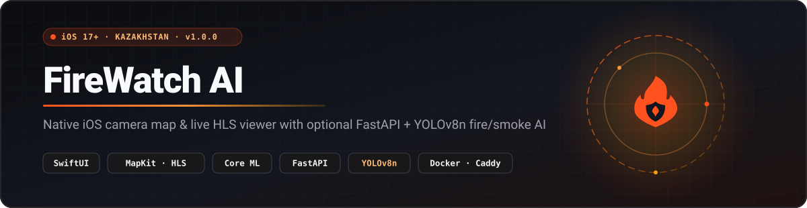
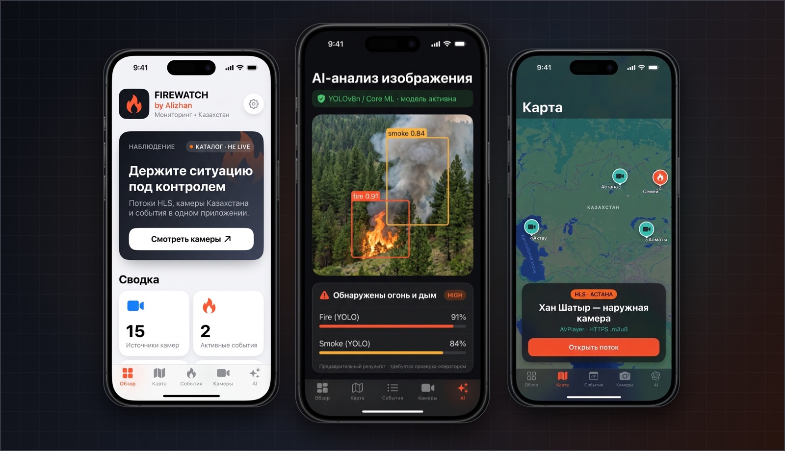
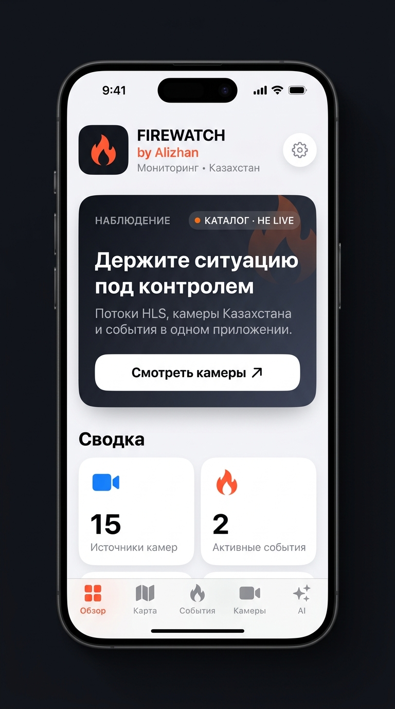
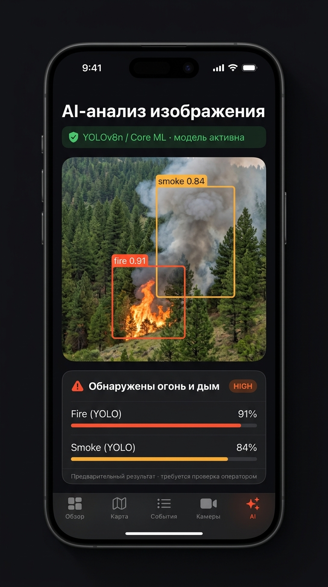
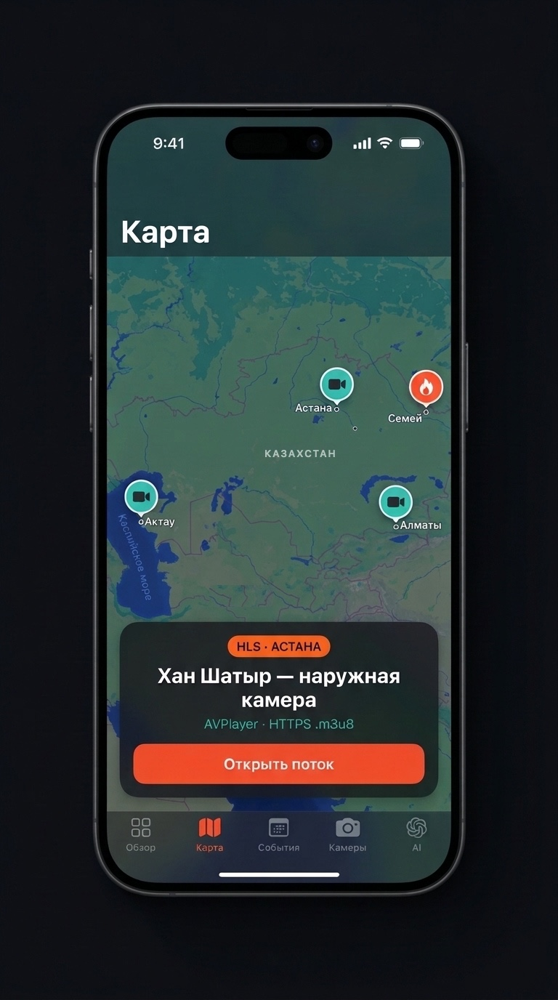
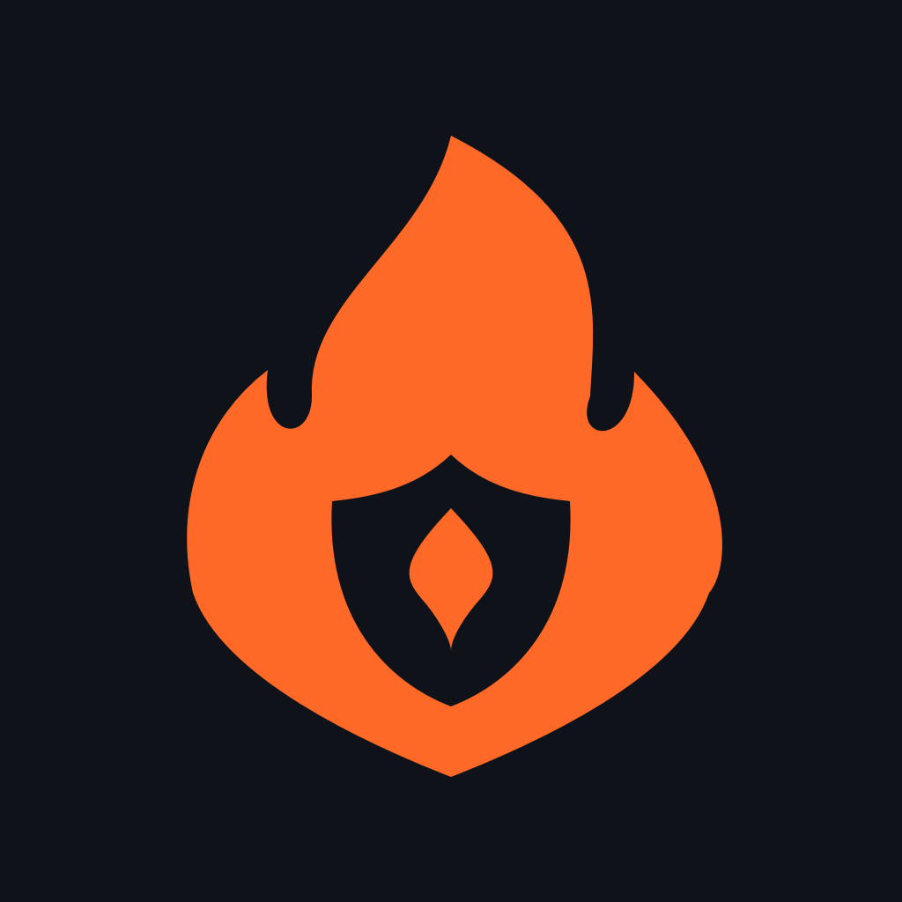
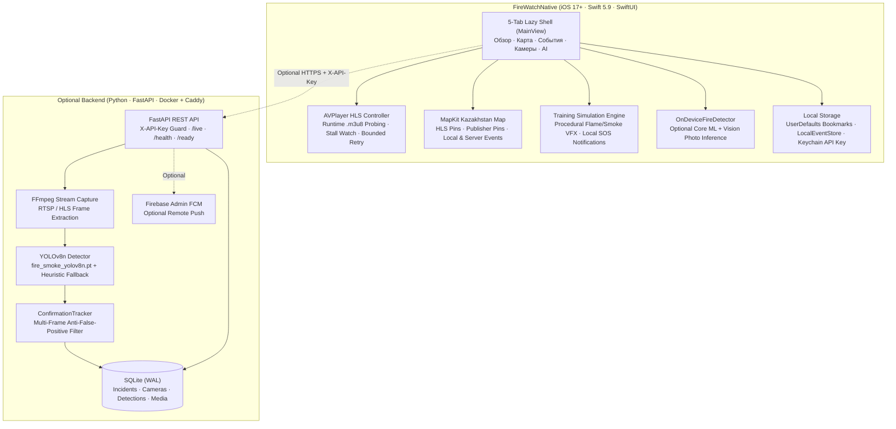

<p align="center">
  
</p>

<p align="center">
  <a href="https://github.com/Alizhan-T/FireWatch-AI/actions/workflows/native-ios.yml">
    
  </a>
  <a href="https://github.com/Alizhan-T/FireWatch-AI/actions/workflows/backend-tests.yml">
    
  </a>
  <a href="https://github.com/Alizhan-T/FireWatch-AI/actions/workflows/kazakhstan-camera-probe.yml">
    
  </a>
</p>

<p align="center">
  
  
  
  
  
  <a href="./LICENSE">
    
  </a>
</p>

<p align="center">
  <strong>Native SwiftUI iPhone application for viewing Kazakhstan public &amp; personal HLS camera feeds, backed by optional on-device Core ML or FastAPI + YOLOv8n fire &amp; smoke analysis.</strong><br/>
  Camera-viewing first and completely server-free on launch — with full optional backend inference, FFmpeg stream capture, SQLite persistence, and Docker + Caddy HTTPS deployment.
</p>

<p align="center">
  <a href="#app-showcase">Showcase</a> ·
  <a href="#architecture">Architecture</a> ·
  <a href="#capability-matrix">Capabilities</a> ·
  <a href="#kazakhstan-camera-catalogue">Cameras</a> ·
  <a href="#quick-start">Quick Start</a> ·
  <a href="#backend-api">API</a> ·
  <a href="#testing--ci-quality-gates">Testing</a> ·
  <a href="#safety--engineering-transparency">Safety</a>
</p>

---

## App Showcase

<p align="center">
  
</p>

### Interface Walkthrough

| Camera-First Dashboard | AI Fire & Smoke Image Analysis | Kazakhstan MapKit & HLS Viewer |
| :---: | :---: | :---: |
|  |  |  |
| `FireWatchDashboard` — high-contrast control center separating catalogued camera counts from verified live playback, quick DEMO/manual event creation, and live AI engine readiness. | `DetectionView` + `OnDeviceFireDetector` + `AIFireAssessment` — photo analysis via local Core ML Vision or FastAPI YOLOv8n with explicit `fire` / `smoke` scores and operator verification prompts. | `MainView` (MapKit) + `CameraViews` — Kazakhstan camera map covering Astana, Almaty, Aktau & Semey with in-app `AVPlayer` HLS playback, bounded reconnects, and stall monitoring. |

<br/>

<table>
  <tr>
    <td width="110" align="center">
      
    </td>
    <td>
      <strong>Programmatic App Icon Generator</strong><br/>
      The high-contrast flame-and-shield <code>1024×1024</code> iOS App Icon is generated natively during XcodeGen builds via <a href="./FireWatchNative/tools/generate_app_icon.swift"><code>FireWatchNative/tools/generate_app_icon.swift</code></a> using built-in macOS AppKit with zero external graphics dependencies.
    </td>
  </tr>
</table>

---

## Architecture

FireWatch AI is designed around a **standalone-first dual architecture**: the native iOS client runs cleanly on a free Apple Personal Team with zero server dependencies, while an optional FastAPI + YOLOv8n backend unlocks server-side stream scanning, multi-frame confirmation, SQLite incident evidence, and remote push alerts.



---

## Capability Matrix

| Capability | iPhone Only (Standalone) | + Local Core ML Export | + Optional FastAPI Backend |
| :--- | :---: | :---: | :---: |
| Browse Kazakhstan public HLS camera candidates (`AVPlayer`) | Yes | Yes | Yes |
| Save personal HTTPS `.m3u8` camera bookmarks (`UserDefaults`) | Yes | Yes | Yes |
| View camera locations & local events on MapKit | Yes | Yes | Yes |
| Run training DEMO flame/smoke simulation & local SOS alerts | Yes | Yes | Yes |
| Offline manual event logging & resolution (`LocalEventStore`) | Yes | Yes | Yes |
| Real AI fire/smoke analysis on user-selected photos | No | **Yes (On-Device Core ML)** | **Yes (Server YOLOv8n)** |
| Scan RTSP/HLS streams via FFmpeg & multi-frame confirmation | No | No | **Yes** |
| Persist server incidents, clips & evidence in SQLite | No | No | **Yes** |
| Remote push notifications (FCM / APNs) | No | No | **Optional setup** |

---

## Kazakhstan Camera Catalogue

The **Камеры** tab includes a Kazakhstan-only catalogue with runtime HTTPS `.m3u8` playlist probing. Streams open **inside the SwiftUI app** (no unexpected Safari redirects), and availability is **never hard-coded as online** — responding playlists are separated from unreachable sources with manual retry controls.

| City | Included Sources | Playback Path | Notes |
| :--- | :--- | :--- | :--- |
| **Astana** | Khan Shatyr (Outdoor & Indoor direct HLS), publisher page, Atameken Business | Native `AVPlayer` HLS + in-app embed / Safari view | Official Khan Shatyr entry URLs obtain fresh session playlists per connection. |
| **Aktau** | 7 public XCOM Aktau coastal & city HLS streams | Native `AVPlayer` HTTPS `.m3u8` | City/coast feeds (not dedicated forestry lookout towers); probed live on open. |
| **Almaty** | 2 Shymbulak HTTPS HLS candidates + publisher views | Native `AVPlayer` HTTPS `.m3u8` | Probed via GitHub Actions manifest audit; device playback still depends on provider uptime. |
| **Semey** | Central Square publisher page (Geocam / `gorset.kz`) | In-app publisher view | Explicitly marked *unstable*; no verified direct HLS stream yet. |
| **Custom** | User-supplied permitted HLS streams (`Мои HLS-камеры`) | Native `AVPlayer` + `UserDefaults` | Supports city tagging (e.g. Astana) and takes priority in training scenarios. |

> **Training Simulation (`DEMO`):** Selecting **«Имитировать пожар»** opens a camera-backed training scene with a continuously animated **procedural SwiftUI flame, smoke, and ember overlay** (`RealisticFireOverlay`) plus an optional scan-line (`DemoScannerOverlay`) and a persistent **`DEMO / НЕ РЕАЛЬНЫЙ ПОЖАР`** label. It schedules an **on-device local notification** (`SOS · ДЕМО · УЧЕБНАЯ ТРЕВОГА`) — no backend call, emergency dispatch, or remote push ever occurs.

---

## Quick Start

### 1. Run the Native iOS App (No Server Required)

Works out of the box with a free **Apple Personal Team** (no paid APNs entitlement required):

```bash
brew install xcodegen
git clone https://github.com/Alizhan-T/FireWatch-AI.git
cd FireWatch-AI/FireWatchNative
xcodegen generate
open FireWatchNative.xcodeproj
```

1. Select the **`FireWatchNative`** scheme and choose your Apple Development Team under **Signing & Capabilities**.
2. Run on an iPhone or iOS 17+ Simulator (`Cmd + R`).
3. Open the **Камеры** or **Карта** tab immediately — no server configuration required.

### 2. Enable On-Device Core ML AI on iPhone (Optional)

The repository bundles the PyTorch checkpoint (`backend/models/fire_smoke_yolov8n.pt`) and a Vision/Core ML inference pipeline (`OnDeviceFireDetector.swift`). To export and bundle the Core ML model on macOS:

```bash
bash FireWatchNative/tools/enable_ai_on_iphone.sh
```

Then reopen `FireWatchNative.xcodeproj`, run **Product → Clean Build Folder**, build to your iPhone, and use **AI → Выбрать фотографию → AI-анализ фото на iPhone · Core ML**. Core ML strictly validates explicit `"fire"` / `"smoke"` class names and image orientation instead of guessing numeric IDs.

### 3. Run the Optional FastAPI + YOLOv8n Backend (Local Dev)

```bash
cd backend
python3 -m venv .venv
source .venv/bin/activate
pip install -r requirements.txt
brew install ffmpeg
uvicorn main:app --host 0.0.0.0 --port 8000
```

In the iPhone app, open **Settings (⚙)** and set your Mac's LAN address (`http://<YOUR_MAC_LAN_IP>:8000`) plus `API_ACCESS_TOKEN` if configured (stored securely in the **iOS Keychain**).

### 4. Production Deployment (Docker Compose + Caddy HTTPS)

For continuous server deployment with automatic TLS via Caddy, non-root Uvicorn, persistent SQLite/media volume (`firewatch_data`), and `X-API-Key` protection:

```bash
cp .env.production.example .env.production
mkdir -p secrets && chmod 700 secrets
# Populate FIREWATCH_DOMAIN and API_ACCESS_TOKEN in .env.production
chmod 600 .env.production
docker compose --env-file .env.production up -d --build
```

> See [deploy/README.md](./deploy/README.md) for full TLS, `CAMERA_AUTO_SCAN`, Firebase Admin push setup, and backup instructions.

---

## Backend API

When `API_ACCESS_TOKEN` is configured, all endpoints except `/live` enforce constant-time `X-API-Key` header verification (`hmac.compare_digest`).

| Method & Endpoint | Auth | Purpose |
| :--- | :---: | :--- |
| `GET /live` | Public | Lightweight process liveness probe |
| `GET /health` | `X-API-Key` | Active detector mode (`real_model` vs `demo_heuristic`), DB & Firebase status |
| `GET /ready` | `X-API-Key` | Returns `200` only when scanner, real YOLO model, FFmpeg & recent camera probes succeed (`503` otherwise) |
| `GET /monitoring/status` · `POST /monitoring/{start,stop}` | `X-API-Key` | Control & inspect background auto-scan worker and multi-frame `ConfirmationTracker` |
| `GET /cameras` · `POST /cameras` · `DELETE /cameras/{id}` | `X-API-Key` | Manage configured RTSP/HLS camera sources |
| `POST /cameras/{id}/check` · `POST /cameras/{id}/analyze` | `X-API-Key` | Capture live frame via FFmpeg and run single-frame YOLO analysis |
| `POST /detect` · `GET /detections` | `X-API-Key` | Upload an image for fire/smoke inference with structured findings |
| `GET /incidents` · `PATCH /incidents/{id}/status` | `X-API-Key` | Inspect evidence snapshots/clips and triage (`new`, `acknowledged`, `resolved`, `false_alarm`) |
| `POST /register_device` · `POST /push/test` | `X-API-Key` | Optional FCM device registration & test alert delivery |

---

## Testing & CI Quality Gates

### Automated GitHub Actions Workflows
- **[native-ios.yml](./.github/workflows/native-ios.yml)** — Generates `FireWatchNative.xcodeproj` via XcodeGen, builds for iOS Simulator, and executes all 6 `XCTest` suites (`AIFireAssessmentTests`, `FirePlumeTests`, `KazakhstanCameraTests`, `LocalEventsTests`, `LocalHLSCameraStoreTests`, `ServerConfigurationTests`).
- **[backend-tests.yml](./.github/workflows/backend-tests.yml)** — Runs all 6 `pytest` suites (`test_api`, `test_capture`, `test_detection`, `test_persistence`, `test_production`, `test_stream_pipeline`).
- **[kazakhstan-camera-probe.yml](./.github/workflows/kazakhstan-camera-probe.yml)** — Audits Kazakhstan public `.m3u8` manifest reachability.

### Model Evaluation & 24-Hour Soak Tooling
```bash
# Evaluate fire/smoke TP/FP/FN/TN & inference latency on labelled CSV manifests
python backend/tools/evaluate_model.py \
  --manifest backend/tests/fixtures/evaluation.csv \
  --repeats 25 \
  --output backend/reports/fixtures.json

# Run continuous remote endpoint reliability & restart tracking
python backend/tools/soak_check.py \
  --url https://YOUR_DOMAIN \
  --duration 86400 \
  --interval 60 \
  --output backend/reports/soak-24h.jsonl
```

> See [docs/STABILITY_CHECKLIST.md](./docs/STABILITY_CHECKLIST.md) for the full physical-device smoke test matrix and camera catalogue policy.

---

## Project Structure

```text
FireWatch-AI/
├── FireWatchNative/                    # Native iOS 17+ SwiftUI application (XcodeGen)
│   ├── project.yml                     # XcodeGen target, Swift 5.9 & Personal Team signing spec
│   ├── FireWatchNative/                # 23 Swift source files (Dashboard, MapKit, AVPlayer, Core ML, Keychain)
│   ├── FireWatchNativeTests/           # 6 XCTest unit test suites
│   ├── tools/                          # AppIcon generator & one-command Core ML export script
│   └── README.md                       # Detailed iOS setup & troubleshooting notes
├── backend/                            # Optional FastAPI + YOLOv8n + FFmpeg server
│   ├── app/                            # FastAPI routes, capture, monitoring, SQLite DB, YOLO & heuristic providers
│   ├── models/fire_smoke_yolov8n.pt    # Trained YOLOv8n PyTorch fire/smoke weights
│   ├── tests/                          # 6 pytest suites + evaluation fixtures
│   ├── tools/                          # Core ML exporter, model evaluator & 24h soak checker
│   └── Dockerfile                      # Non-root production container image
├── deploy/                             # Caddyfile (auto-HTTPS) & production deployment runbook
├── docs/                               # Physical-device stability & QA checklist
├── assets/                             # Hero banner, showcase triptych, UI screen previews & AppIcon
├── .github/workflows/                  # Native iOS CI, backend pytest CI & Kazakhstan camera probe
├── compose.yaml                        # Docker Compose stack (backend + Caddy)
├── .env.production.example             # Production environment template
├── CONTRIBUTING.md                     # Contribution & transparency guidelines
└── LICENSE                             # MIT License
```

---

## Safety & Engineering Transparency

> [!IMPORTANT]
> **FireWatch AI is an experimental operator-assistance and camera-viewing tool — NOT a certified wildfire detection or emergency dispatch system.**
>
> - **Stream Permissions:** Access only permitted camera URLs. A publicly viewable stream is **not** a grant of permission to record, redistribute, or run automated AI inference on third-party feeds.
> - **Honest Status & DEMO Separation:** Catalogued camera entries are *candidates*, not uptime guarantees. Synthetic DEMO fire/smoke VFX, scan-line animations, and demo color heuristics are visibly labelled and never trigger emergency dispatches or real alerts.
> - **Human Verification Required:** Single-frame AI scores (Core ML or YOLOv8n) are preliminary indicators that require human verification and field-specific false-positive/negative calibration before operational use.
> - **Physical-Device Verification:** Green simulator builds and HTTP playlist probes do not replace live testing on a physical iPhone across Wi-Fi and cellular networks.

---

## Documentation & Links

| Document | Description |
| :--- | :--- |
| [FireWatchNative/README.md](./FireWatchNative/README.md) | Deep-dive iOS setup, Apple Personal Team signing, Core ML export & troubleshooting |
| [deploy/README.md](./deploy/README.md) | Production VPS deployment with Docker Compose, Caddy TLS, `/ready` checks & backups |
| [docs/STABILITY_CHECKLIST.md](./docs/STABILITY_CHECKLIST.md) | CI gates, 9-point physical iPhone smoke checklist & camera catalogue policy |
| [CONTRIBUTING.md](./CONTRIBUTING.md) | Development workflow, test commands & safety principles |

---

## License & Author

Distributed under the **MIT License**. See [LICENSE](./LICENSE) for details.

Built by **[Alizhan Toleukhan](https://github.com/Alizhan-T)** · [Portfolio](https://alizhan-t.github.io/)
